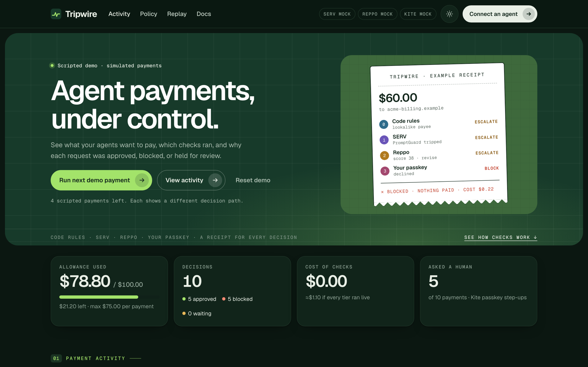

<div align="center">


# Tripwire

**A tiered co-signer for AI agent payments on Kite.**

Allowances let your agents spend without asking. Tripwire makes sure they should.

[](https://github.com/drained69/Tripwire/actions/workflows/ci.yml)


[](LICENSE)

[Live demo](https://tripwirev1.up.railway.app) · [Getting started](#getting-started) · [Documentation](#documentation) · [API](docs/api.md) · [Contributing](CONTRIBUTING.md)

<br />



</div>

---

## Table of contents

- [About](#about)
- [Features](#features)
- [How it works](#how-it-works)
- [Getting started](#getting-started)
- [Usage](#usage)
- [Configuration](#configuration)
- [Sponsor integrations](#sponsor-integrations)
- [Results](#results)
- [Project structure](#project-structure)
- [Testing](#testing)
- [Documentation](#documentation)
- [Roadmap](#roadmap)
- [Contributing](#contributing)
- [Security](#security)
- [License](#license)
- [Acknowledgments](#acknowledgments)

## About

[Kite](https://gokite.ai)'s Agent Passport lets a team give its AI agents a standing allowance, so they can pay for APIs, compute and vendors without a human signing every transaction. Spending caps limit **how much** an agent can spend, but nothing checks **whether a particular payment is right**: a lookalike payee, an invoice that says "change the payee wallet", the same charge twice, or one large payment split into small ones.

Tripwire sits between your agents and their Kite allowance. Every payment climbs a ladder of checks that gets stricter as more money is at risk, from free code rules up to the owner's passkey, and every decision comes with a receipt showing what ran, what it cost and why.

**Live demo:** [tripwirev1.up.railway.app](https://tripwirev1.up.railway.app) — press **Spend a real payment** to send a few hundredths of a cent through the full ladder (SERV, Reppo and a real Kite payment) from a shared, capped allowance. The dashboard's admin actions stay behind the owner token.

Built for the **OpenServ SERV Hackathon, Edition 02 (Kite track)**.

## Features

- **Tiered verification**: deterministic rules → OpenServ SERV reasoning → Reppo network verdict → Kite passkey step-up. Cheap checks run on everything; expensive ones only where the risk is.
- **Fail-closed by design**: any tier can block, any failure escalates, and nothing is paid until the receipt says `approved`.
- **Attack detection**: lookalike payees, prompt injection in vendor text, duplicate and split payments, unusual amounts, and payees missing from Kite's service directory.
- **Never pays twice**: idempotency keys are saved before money moves, and unconfirmed outcomes stay counted until rechecked.
- **Plain-English policy**: write rules like *"Never pay more than $25 to a new vendor"*. SERV compiles them, code validates them, and you approve the exact diff.
- **Learns from you and Reppo**: trusted payees earn fewer interruptions; report a paid payment as a problem and you approve that payee for 30 days while its agent gets stricter checks; Reppo's agreement with your decisions is tracked on the dashboard.
- **Receipts for every decision**: a timeline of each check, its cost, latency, whether it ran `live` or `mock`, and the sponsors' own evidence: SERV request ids, Reppo evaluation ids, Kite transaction hashes.
- **Agent-ready**: a dependency-free MCP server (`tripwire_pay`, `tripwire_receipt`, `tripwire_policy`) and a JSON HTTP API.
- **Live dashboard**: decisions in real time, allowance and cost metrics, payee trust, policy editor and replay chart, in light and dark themes.
- **Zero runtime dependencies**: TypeScript in strict mode, run directly by Node with no build step.

## How it works


| Tier | Runs when | Checks | Cost |
|---|---|---|---|
| **0 · Code rules** | Every payment | Caps, allow/deny lists, your rules, lookalikes, duplicates, splits, unusual amounts, injected instructions, Kite directory | ~$0 |
| **1 · SERV reasoning** | ≥ $1 or a new payee | Does the purchase follow from the agent's task? (SERV Multipath + Kronos reasoning graph, PromptGuard, Shadow Agent) | ~$0.0008 |
| **2 · Reppo verdict** | ≥ $20, a serious flag, or SERV escalates | A panel of independent evaluators scores the payment and routes it ship / review / block | 440 credits ($0.22) |
| **3 · Kite passkey** | Reppo routes it to review, or the price can't be confirmed | The owner approves a one-shot session capped at this exact payment | one tap |

Full details on routing, each tier and calibration: **[docs/how-it-works.md](docs/how-it-works.md)**.

## Getting started

### Prerequisites

- [Node.js](https://nodejs.org) **23.6 or newer** (the repository's `.nvmrc` pins 24)
- Optional, for real payments only: Kite's `kpass` CLI 6.8.9+ ([deployment guide](docs/deployment.md))

### Installation

```bash
git clone https://github.com/drained69/Tripwire.git
cd Tripwire
```

That's it: Node runs the TypeScript sources directly, so there is nothing to build. Running `npm install` is only needed for development (it installs the TypeScript compiler for type-checking).

### Run the demo

```bash
npm start
```

Open **http://127.0.0.1:8787** and press **Run next demo payment**. Three agents share a $100 allowance, and seven scripted payments each show a different tier deciding: a tiny payment approved by code rules, a lookalike invoice with injected instructions blocked, a split payment caught, a deny-listed payee stopped instantly.

The demo needs no accounts, keys or money. Each sponsor check falls back to a clearly labelled offline stand-in.

## Usage

### Commands

| Command | Description |
|---|---|
| `npm start` | Start the dashboard and API on `http://127.0.0.1:8787` |
| `npm run demo` | Run the scripted stage demo in the terminal |
| `npm run replay` | Run the six-week calibration replay (offline) |
| `npm run mcp` | Start the MCP server for agents |
| `npm run doctor` | Check a live setup without paying anything |
| `npm test` | Run the test suite |
| `npm run typecheck` | Strict TypeScript check (after `npm install`) |
| `npm run check` | Type-check, then test (what CI runs) |

### Connect an agent

Add Tripwire to any MCP client, and the agent pays through `tripwire_pay` instead of calling Kite directly:

```bash
claude mcp add tripwire \
  --env TRIPWIRE_URL=http://127.0.0.1:8787 \
  --env TRIPWIRE_AGENT_KEY=<this agent's key> \
  -- node /path/to/tripwire/src/mcp.ts
```

### Submit a payment over HTTP

```bash
curl -X POST http://127.0.0.1:8787/api/intents \
  -H 'Content-Type: application/json' \
  -H "Authorization: Bearer $AGENT_KEY" \
  -d '{
    "requestKey": "invoice-1042",
    "agentTask": "Pay approved vendor invoices for the Acme Design brand refresh project",
    "payee": "acme-billing.example",
    "payeeName": "Acme Design (billing)",
    "amountUsd": 60,
    "category": "design invoice",
    "purpose": "Invoice #1042 for brand refresh milestone 2"
  }'
```

The response is `202 { "id": "…", "receipt": "/api/receipts/…" }`. The decision streams over server-sent events, and the receipt is viewable at `/r/<id>`. See the **[API reference](docs/api.md)** for every endpoint, field and the receipt format.

### Write policy in plain English

In the dashboard's **Plain-English policy** panel:

> Never pay more than $25 to a new vendor. Block payments to fastcash.example. Only pay invoices on weekdays.

Tripwire shows exactly what will change (a $25 cap for new payees, `fastcash.example` blocked) and what it can't express (the weekday rule). Nothing applies until you approve.

## Configuration

Copy the example file and fill in only what you need. Every integration is optional in the demo.

```bash
cp .env.example .env
```

| Variable | Default | Description |
|---|---|---|
| `SERV_API_KEY` | — | Enables live SERV checks (tier 1) and the live policy compiler |
| `REPPO_API_KEY` or `REPPO_CREDIT_TOKEN` | — | Enables live Reppo verdicts (tier 2). An API key from eval.reppo.xyz comes with free sign-up credits |
| `KITE_MODE` | `mock` | Set to `kpass` for real payments through Kite |
| `TRIPWIRE_OWNER_TOKEN` | — | Dashboard sign-in; required in live mode or off localhost |
| `TRIPWIRE_AGENT_KEYS` | — | `agentId:key,…`; required in live mode |
| `POLICY_FILE` | — | Starting policy for live mode (see `policy.example.json`) |
| `PORT` / `HOST` | `8787` / `127.0.0.1` | Where the server listens |

The full list, and the step-by-step guide to real payments, are in **[docs/deployment.md](docs/deployment.md)**.

## Sponsor integrations

| Sponsor | Used for | Status |
|---|---|---|
| **OpenServ SERV** | Tier 1 reasoning through SERV's graph features (**Multipath**, audited by **Kronos**), strict JSON schema, **PromptGuard**, **Shadow Agent**, reasoning effort; the plain-English policy compiler; a benchmark (`npm run serv:bench`) | ✅ Verified live, benchmarked |
| **Reppo** | Tier 2 panel evaluation (`/api/v1/agents/evals` or `/api/v1/x402/evals`): score 0–100, route ship / review / block; its track record against the owner feeds the dashboard | 🟡 Built and tested to Reppo's current API; live once a key or credit token is set |
| **Kite** | Payments with `kpass session execute` and idempotency keys; passkey step-up sessions; `ksearch` service catalog; transaction hashes from `kpass activity` | ✅ Real payment made: $0.001 on Base, tx `0xdba0dc85…dfbb20` |

Evidence for each: [docs/architecture.md](docs/architecture.md#integration-status).

## Results

A six-week replay of seeded traffic (46 payments a week across three agents, 5 of them bad), run with and without calibration:

| | With calibration | Without |
|---|---|---|
| Bad payments blocked | **30 / 30** | 30 / 30 |
| Legitimate payments blocked | **0** | 0 |
| Owner interruptions on legitimate payments | **4** | 14 |
| Cost of checks at live prices | **$21.74** | $22.40 |

Reproduce with `npm run replay`. The replay uses offline stand-ins for SERV and Reppo, so it measures the ladder's routing and calibration, not the reviewers' judgement. [More on the methodology](docs/how-it-works.md#results).

**Live SERV benchmark.** Ten labelled payments (five fine, five not: off-task purchases, an injected invoice, changed payment details), each run twice through the live tier-1 check:

| SERV setting | Correct | Bad payments let through | Good payments sent to the owner | Median latency | Cost (20 checks) |
|---|---|---|---|---|---|
| Plain SERV | 18 / 20 | **0** | 2 | 7.7 s | $0.018 |
| SERV Multipath + Kronos (default) | 17 / 20 | **0** | 3 | 6.4 s | $0.017 |

Neither setting let a bad payment through. The false alarms come from PromptGuard, which fires inconsistently on harmless payments; that costs an owner interruption, never money. Reproduce with `npm run serv:bench` (a few cents of SERV credit).

**Real money.** Tripwire's first live payment: $0.001 to `agent402.tools`, a service in Kite's catalog. The code rules confirmed the merchant's x402 price and its catalog listing, SERV passed it, and Kite paid from the account allowance on Base. The merchant answered HTTP 200, and Kite's activity log records the transaction `0xdba0dc8573fbddcdd0b6d2ff5e8c936f84372afa277b510dbd99a33432dfbb20`.

## Project structure

```text
tripwire/
├── src/
│   ├── server.ts           HTTP API, server-sent events, static pages
│   ├── engine.ts           the verification ladder and payment flow
│   ├── tiers/              tier 0 rules, tier 1 SERV, tier 2 Reppo
│   ├── adapters/           Kite (kpass, ksearch) and the x402 price check
│   ├── auth.ts             owner sign-in and agent API keys
│   ├── policyCompiler.ts   plain-English policy → validated rules
│   ├── calibration.ts      per-payee threshold learning
│   ├── mcp.ts              MCP server for agents
│   └── …                   config, validation, types, replay, demo scenarios
├── public/                 dashboard, receipt and docs pages
├── scripts/                demo, replay and doctor commands
├── test/                   node:test suites
├── docs/                   detailed documentation
└── video/                  Remotion project for the demo video
```

Full layout with every file: [docs/architecture.md](docs/architecture.md#project-layout).

## Testing

```bash
npm install
npm run check
```

41 tests cover every tier, routing, calibration and the feedback loop, the Kite adapter (against a simulated `kpass` covering each documented outcome, including Kite's activity log), Reppo's submit-and-poll API (against a local stub), SERV's model features, the price check, authentication, concurrent payments, fail-closed error handling, and the real HTTP server end to end. Tests make no network calls. CI runs them on Node 24 and 25 for every push. See [docs/development.md](docs/development.md).

## Documentation

| Guide | Contents |
|---|---|
| [How it works](docs/how-it-works.md) | The ladder, routing rules, each tier, calibration, plain-English policy, the stage demo, results |
| [Architecture and security](docs/architecture.md) | Component and sequence diagrams, design choices, security model, integration status |
| [API and agent integration](docs/api.md) | MCP tools, HTTP endpoints, intent fields, receipt format |
| [Deployment and configuration](docs/deployment.md) | Going live with real Kite payments, what protects the money, all variables |
| [Development](docs/development.md) | Tooling, CI, test coverage, known limitations |

The running server also serves documentation at `/docs`.

## Roadmap

- [x] Four-tier verification ladder with receipts
- [x] SERV reasoning with Multipath, Kronos, PromptGuard and Shadow Agent, and a benchmark
- [x] Reppo panel verdicts on the current API, with a track record against the owner
- [x] Kite payments, passkey step-up and directory checks, with a first real payment on Base
- [x] Plain-English policy, calibration and owner feedback, MCP server, dashboard
- [ ] A live passkey step-up and a live Reppo verdict on the same real payment
- [ ] Cache verdicts for repeat (payee, purpose) pairs to cut latency
- [ ] Multiple owners, roles and a database backend

Known limitations are listed in [docs/development.md](docs/development.md#limitations-and-roadmap).

## Contributing

Contributions are welcome. Please read [CONTRIBUTING.md](CONTRIBUTING.md) for the development setup and pull request checklist, and run `npm run check` before opening a pull request.

## Security

Tripwire guards real payments. Please report vulnerabilities privately as described in [SECURITY.md](SECURITY.md), not in public issues. The threat model is in [docs/architecture.md](docs/architecture.md#security-model).

## License

Distributed under the MIT License. See [LICENSE](LICENSE).

## Acknowledgments

- [OpenServ](https://openserv.ai) for SERV reasoning, PromptGuard and Shadow Agent
- [Reppo](https://reppo.xyz) for the Eval API
- [Kite](https://gokite.ai) for Agent Passport and the `kpass` / `ksearch` CLIs
