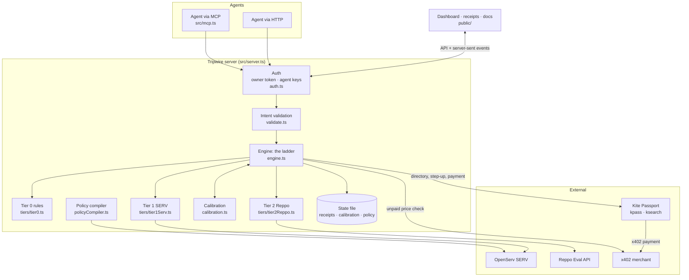
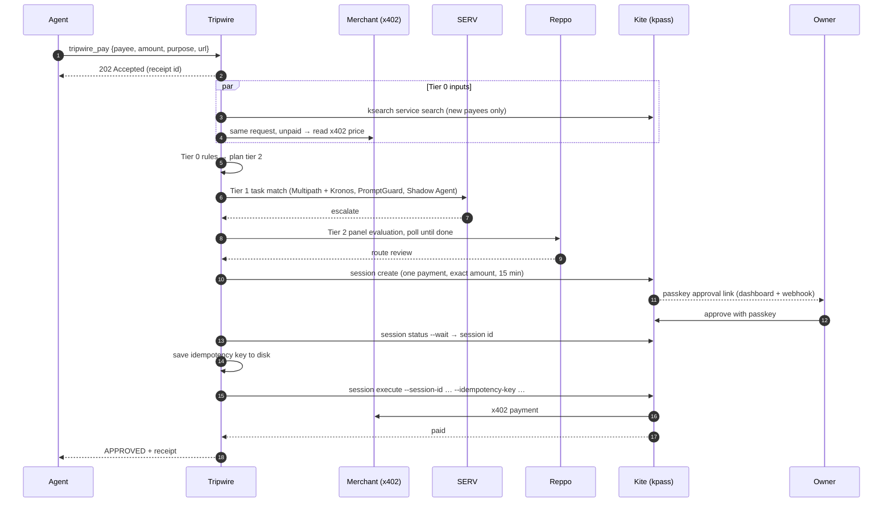

# Architecture and security

Components, the life of a payment, design choices, the security model, sponsor integrations and the source layout.

[← Back to the README](../README.md)

## Contents

- [Architecture](#architecture)
- [Security model](#security-model)
- [Sponsor technology](#sponsor-technology)
- [Integration status](#integration-status)
- [Project layout](#project-layout)

## Architecture



**One payment, end to end** (live mode, a $60 invoice that needs the owner):



Design choices worth noting:

- **The engine is pure and testable.** Every external system sits behind an adapter with an offline stand-in, so the full ladder runs in tests, the replay and the demo without network access. Live mode never uses a stand-in: an unconfigured check hands the payment to the owner.
- **Concurrency is handled before the first `await`.** A payment is registered as in flight synchronously, so two payments arriving together see each other (duplicates, splits, reserved allowance), and a retried `requestKey` finds the first one.
- **State is a single JSON file**, written atomically (temp file and rename, mode 600). The idempotency key is written *before* money moves.
- **No framework, no runtime dependencies.** Node's `http`, `https`, `child_process` and `crypto` cover everything; `kpass` runs through `execFile` with no shell.

## Security model

- **Fail closed.** Errors escalate. The only paths to payment are a pass at the planned tier or an explicit owner approval. An unexpected internal error blocks a payment that hasn't been paid, and marks one mid-payment as unconfirmed (still counted).
- **Untrusted vendor text.** It is pattern-screened at tier 0, fenced and labelled for SERV (with fence tags stripped), and judged as a criterion by Reppo. It is never executed or followed.
- **Validated model output.** SERV's answer must match the schema exactly, or the check fails and escalates. Every SERV call has a timeout.
- **Canonical payees.** Payees are compared in one normalized form everywhere (intents, policy files, compiled rules), so case or a trailing dot can't dodge a deny list or impersonate a known payee.
- **Least-privilege step-up.** An approval opens a session that can pay this amount, once, within 15 minutes, and the payment executes through exactly that session.
- **Price and payee verified before paying (live).** The merchant's own x402 price must not exceed the requested amount, and the URL must belong to the payee. See [What protects the money](deployment.md#what-protects-the-money-in-live-mode).
- **Never pays twice.** Idempotency keys are written to disk before money moves; unconfirmed outcomes stay counted and are only rechecked with the same key.
- **No splitting around review.** Payments still being checked count against the allowance, and an agent's recent payments to a payee are added up before choosing the tier.
- **Policy changes are reviewed.** SERV only proposes rules; code validates them, and nothing applies until the owner approves the exact diff. No sentence can be dropped silently.
- **No secrets in public evaluations.** Reppo payloads carry only payment facts.
- **Signed-in owner, keyed agents.** With an owner token, the dashboard requires sign-in and each agent has its own key; agents can submit payments and read only their own receipts and limits. The server won't start in live mode, or on a non-loopback `HOST`, without an owner token, and the open demo only answers requests addressed to localhost (so a website can't reach it through DNS rebinding). Cookies are HttpOnly and SameSite=Strict, cross-site writes are refused, pages carry a strict Content-Security-Policy, and sign-in attempts are rate-limited. Secrets are compared in constant time.
- **Durable, separate state.** State is written atomically (temp file + rename, mode 600). Live mode uses its own file and refuses to start on an unreadable one rather than silently starting empty. Receipts left waiting at shutdown are recorded as blocked; a payment interrupted mid-flight is marked unconfirmed, never forgotten. `kpass` runs through `execFile` with no shell.
- **Replays never spend.** `runReplay` forces offline adapters whatever the configuration.

To report a vulnerability, see [SECURITY.md](../SECURITY.md).

## Sponsor technology

| Sponsor | Feature | Where Tripwire uses it | Status |
|---|---|---|---|
| **OpenServ SERV** | Reasoning API with **Multipath** and **Kronos** (model feature suffix), strict `json_schema`, `reasoning_effort` | Tier 1 task check; compiling plain-English rules into policy; `npm run serv:bench` | ✅ live, benchmarked |
| | **PromptGuard** (`serv_prompt_guard`) | Every tier-1 call and the policy compiler: stops vendor text that tries to override the checker | ✅ live, seen firing |
| | **Shadow Agent** (`serv_shadow_agent`) | Every tier-1 call: validates the verdict against a hint and makes the model revise | ✅ enabled; every receipt records SERV's request id |
| **Reppo** | Eval API panel evaluations (score 0–100, route ship / review / block), by API key or x402 credit token | Tier 2 network verdict; Reppo's agreement with the owner is tracked | 🟡 built and tested to the current API; needs a key or token to run live |
| **Kite** | Agent Passport: account allowance, spending sessions, idempotent x402 execute, activity log | Payments via `kpass session execute` with an idempotency key; a passkey-approved session capped at exactly one payment for every step-up; transaction hashes and rechecks from `kpass activity` | ✅ real payment made on Base (`0xdba0dc85…`) |
| | Service catalog (`ksearch service search`) | Unlisted new payees get network review | ✅ checked live against the real catalog |
| | Agent integration (Passport skills, MCP) | Tripwire ships as an MCP server: any agent pays through `tripwire_pay` | ✅ tested with an MCP client |

See [Integration status](#integration-status) for the evidence behind each line.

## Integration status

| Sponsor | Status | Evidence |
|---|---|---|
| **SERV Reasoning** | ✅ **Verified live, benchmarked** | `gpt-5.4-mini-serv-kronos-multipath` (Multipath turns the checker's branching rules into a reasoning graph; Kronos audits and repairs it; SERV caches it per organization) with a strict `json_schema`, `reasoning_effort: low`, PromptGuard and Shadow Agent. Every receipt keeps SERV's `x-openserv-request-id`, traceable in the SERV console. In a live benchmark of 20 labelled checks per setting, neither plain SERV nor Multipath + Kronos let a bad payment through (17–18 of 20 correct; the misses were PromptGuard false alarms). About $0.0008 and 6–8 s per check; the first Kronos audit of a prompt takes ~35 s. |
| **Reppo** | 🟡 **Built to the current API; live with a key** | Reppo retired the lite endpoint and sandbox in favour of panel evaluations. Tripwire submits `{ taskType: "action", input }` to `/api/v1/agents/evals` (API key) or `/api/v1/x402/evals` (credit token), polls until `COMPLETED` or `FAILED`, and acts on `result.route`. The exchange is tested against a local stub; a live verdict needs `REPPO_API_KEY` (free sign-up credits) or a credit token. |
| **Kite** | ✅ **Real payment made** | kpass 6.13.1 and ksearch 6.13.1, account allowance on Base. Tripwire paid $0.001 to `agent402.tools`: tier 0 confirmed the merchant's x402 price (cheapest option on a chain Kite pays) and its catalog listing, SERV passed it, and `kpass session execute --use-allowance --idempotency-key …` paid. The merchant answered HTTP 200, the wallet moved by exactly $0.001, and `kpass activity` records transaction `0xdba0dc8573fbddcdd0b6d2ff5e8c936f84372afa277b510dbd99a33432dfbb20`. Two differences from Kite's published reference were found and handled: the execute reply carries no transaction hash (Tripwire reads it from the activity log), and kpass 6.13.1 has no `session updates` (held payments are rechecked from the activity log). The passkey step-up is tested against a simulated kpass. |

## Project layout

```text
tripwire/
├── src/
│   ├── server.ts            HTTP API, server-sent events, static pages, startup safety checks
│   ├── engine.ts            the ladder: routing, escalation, step-up, payment, fail-closed errors
│   ├── tiers/
│   │   ├── tier0.ts         deterministic rules
│   │   ├── tier1Serv.ts     SERV task-match check (Multipath + Kronos, PromptGuard, Shadow Agent)
│   │   └── tier2Reppo.ts    Reppo verdict
│   ├── adapters/
│   │   ├── kite.ts          kpass payments, passkey step-up session, outcome handling, ksearch directory
│   │   └── x402.ts          merchant price check (x402 challenge) with private-address guard
│   ├── auth.ts              owner sign-in, agent API keys, same-origin checks, login rate limit
│   ├── policyCompiler.ts    plain-English rules → validated policy (SERV)
│   ├── calibration.ts       per-payee threshold learning
│   ├── mcp.ts               MCP server: tripwire_pay / _receipt / _policy
│   ├── replay.ts            synthetic multi-week replay (always offline)
│   ├── scenarios.ts         demo agents, stage script, synthetic traffic
│   ├── config.ts            .env loading, demo policy, policy-file validation, integration modes
│   ├── validate.ts          intent validation and payee normalization
│   └── types.ts             domain types
├── public/                  dashboard, receipt and docs pages (plain HTML/CSS/JS, no framework)
├── scripts/                 demo.ts, replay.ts, doctor.ts (read-only live setup check)
├── test/
│   ├── tripwire.test.ts     tiers, routing, calibration, adapters, live engine, auth, concurrency
│   └── hardening.test.ts    normalization, fail-closed errors, config parsing, HTTP server end to end
├── docs/                    how it works, architecture, API, deployment, development
├── .github/workflows/ci.yml type-check, tests, demo and replay on Node 24 and 25
├── policy.example.json      starting policy for live mode
├── tsconfig.json            strict type-checking (Node strips types at runtime)
├── CONTRIBUTING.md          development setup and pull request checklist
├── CHANGELOG.md             release notes
├── SECURITY.md              how to report a vulnerability
└── LICENSE                  MIT
```
